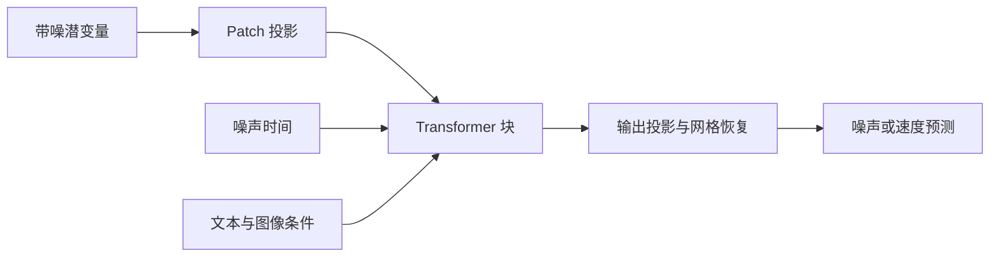

# 第 17 章 视频模型

上一章把视频压缩成了潜变量。对于 81 帧、480×832 的输入，一种常见配置会得到 21×60×104 的潜网格；再经过 patch 划分，生成网络需要处理数万个 token。

这些位置之间存在许多不同的关系。庭院中的屋檐在多帧中重复出现，行人会从画面左侧走到右侧，门框在被遮挡后还应恢复原来的形状。文字条件同时规定场景、动作和相机运动。视频模型需要在一次次噪声预测或速度预测中，共同处理这些信息。

我们先从图像网络加入时间层的做法开始，再进入 Video DiT，最后对照 CogVideoX 与 Wan，查看一个完整模型怎样组织输入、训练目标和生成过程。

## 17.1 图像模型迁移

### 保留图像能力

图像生成模型已经学会物体外观、光照和纹理。复用这些参数，可以减少视频训练所需的工作。输入特征 \([B,C,F,H,W]\) 沿时间展开后，二维网络可以把它当作 \(BF\) 张图像处理：

\[
[B,C,F,H,W]
\longrightarrow[BF,C,H,W].
\]

这样的空间层分别处理每一帧。为了让信息跨帧传播，需要加入时间卷积或时间注意力。

例如，在图像残差块后接一个时间模块：

\[
\tilde h=F_{\mathrm{spatial}}(h),\qquad
h'=\tilde h+F_{\mathrm{temporal}}(\tilde h,t).
\]

这里的 \(t\) 是噪声时间。时间模块可以读取多帧特征，从视频数据中学习相邻画面的关系。若把时间分支的末端投影初始化为零，初始网络的行为接近原来的图像网络；训练开始后，时间分支再逐步产生有效输出。只将末端投影置零，可以让内部特征保留正常的初始化。

### AnimateDiff

AnimateDiff 把时间建模组织成可插入图像扩散网络的运动模块。[1] 一个典型的时间注意力层先把特征改排为

\[
[B,C,F,H,W]
\longrightarrow[BHW,F,C].
\]

每个空间位置对应一条长度为 \(F\) 的时间序列。注意力沿这条序列计算，得到同一位置在不同帧之间的关联，再把结果恢复到原来的网格。

图像骨干负责提供较强的外观先验，运动模块通过视频训练补充时间变化。模块迁移到个性化图像模型时，能够复用一部分风格和主体能力，但最终效果仍取决于两者的特征分布是否兼容。人物外观很清楚而动作僵硬，可能与运动训练不足有关；动作自然但主体变形，也需要检查图像骨干与时间模块的配合。

### Stable Video Diffusion

Stable Video Diffusion 同样沿用了图像模型的空间能力，并通过时间层、视频数据与分阶段训练扩展到视频。[2] 其论文讨论了图像预训练、视频预训练和高质量视频微调之间的关系。

在公开的 SVD 图生视频配置中，图像信息通过视觉编码与潜变量条件进入网络，还会使用帧率、运动强度和条件图像加噪程度等辅助条件。调整输入图片的噪声强度，会改变模型依赖原图细节的程度，也可能影响能够产生的运动。

论文中的训练体系、发布模型的条件接口和应用中的输入选项，需要逐项对应。一个已经训练为图像条件的检查点，不能仅靠额外输入文本向量就获得可靠的文本控制。

## 17.2 时空注意力

### 分解注意力

设潜网格有 \(F'\) 个时间位置，每个时刻有 \(S=H'W'\) 个空间位置。忽略 patch 后的尺寸差别，完整序列长度为 \(N=F'S\)。

空间注意力分别在各时刻计算，配对数量约为

\[
F'S^2.
\]

时间注意力分别在各空间位置计算，配对数量约为

\[
S(F')^2.
\]

把两者交替使用，总量级为

\[
O\!\left(F'S^2+S(F')^2\right).
\]

与完整时空注意力的 \(O((F'S)^2)\) 相比，这种分解降低了计算量。空间层先在一帧内传播信息，时间层再在不同帧之间传播，经过多层后可以形成较大的时空感受野。

但时间注意力中的同一网格位置，未必始终对应同一个物体。行人从左边走到右边后，身体出现在不同坐标上。模型需要依靠空间层、时间层和多尺度特征的共同作用，才能把这些位置联系起来。时间注意力本身没有显式建立物体轨迹。

### 完整时空注意力

完整注意力允许一个 token 查询所有时空位置：

\[
A_{ij}
=
\operatorname{softmax}_j
\left(
\frac{q_i^\top k_j}{\sqrt{d_h}}
\right),
\qquad
h'_i=\sum_j A_{ij}v_j.
\]

其中 \(i,j\) 都可以来自不同帧、不同空间位置。前一帧左侧的人物特征可以直接与后一帧右侧的特征发生关联，这对大幅运动和遮挡关系提供了更灵活的建模方式。

这种关联仍然由数据学习。注意力权重较高，只表示网络在当前层使用了相应特征，不能据此直接断定两个位置属于同一个真实物体。

### 窗口与稀疏连接

视频较长时，可以限制注意力范围，例如只看邻近的时空窗口，交替移动窗口，或为部分位置保留全局连接。这样会改变模型能够直接读取的上下文。

局部窗口适合处理纹理和短时运动，但相隔较远的人物状态需要经过多层传播，或依赖专门的全局信息。稀疏结构能否保留长时一致性，需要结合任务验证：短距离的平移与人物离开画面后再次出现，对上下文的要求差别很大。

FlashAttention 优化的是注意力计算与访存过程，窗口和稀疏连接则改变了参与计算的位置集合。两种方式可以配合使用，但对网络行为的影响需要分别分析。

## 17.3 Video DiT

### 一个生成块

Video DiT 先把视频潜变量划分为时空 patch，再经过多层 Transformer，最后恢复为原来的潜网格。



在具有独立文本交叉注意力的结构中，一个块可以示意为

\[
\begin{aligned}
h_1&=h+g_a(t)\odot
\operatorname{SelfAttn}(\operatorname{AdaNorm}(h,t)),\\
h_2&=h_1+
\operatorname{CrossAttn}(\operatorname{Norm}(h_1),c),\\
h_3&=h_2+g_f(t)\odot
\operatorname{FFN}(\operatorname{AdaNorm}(h_2,t)).
\end{aligned}
\]

\(c\) 是条件特征，\(g_a,g_f\) 控制残差分支的输出幅度。条件归一化可以写成

\[
\operatorname{AdaNorm}(h,t)
=(1+\gamma(t))\odot\operatorname{Norm}(h)+\beta(t).
\]

\(\gamma,\beta\) 由噪声时间嵌入计算。实际模型可能共享时间映射、增加逐层参数，或者把文本与视频放进联合注意力；这里的式子用于说明各类信息如何进入一个生成块。

### 速度预测

以线性条件路径为例，先编码得到干净视频潜变量 \(z_0\)，再抽取标准高斯噪声 \(\epsilon\)：

\[
z_t=(1-t)z_0+t\epsilon,
\qquad t\in[0,1].
\]

本章约定 \(t=0\) 对应数据端，\(t=1\) 对应噪声端，因此条件路径的速度为

\[
u_t=\frac{\mathrm dz_t}{\mathrm dt}=\epsilon-z_0.
\]

训练目标可写为

\[
\mathcal L
=\mathbb E_{z_0,\epsilon,t,c}
\left[
 w(t)\,\operatorname{mean}
 \left(v_\theta(z_t,t,c)-u_t\right)^2
\right].
\]

网络输出与潜变量具有相同尺寸。损失中的平均可以在样本内部按有效位置计算，再在批量中取平均，避免长视频或大画面仅因元素更多就获得更大的权重。若实际训练希望按 token 数加权，也应明确这一选择。

这里使用的是 Flow Matching 的路径速度。扩散中的某些 \(v\)-prediction 配置定义为 \(\alpha_t\epsilon-\sigma_tz_0\)，需要按对应日程换算。查看名为 `noise_pred` 的代码变量时，也要结合训练目标与调度器判断其含义。

### 从预测到生成

推理从 \(z_1\sim\mathcal N(0,I)\) 开始，按从 1 到 0 的时间方向积分。若用最简单的 Euler 更新，便有

\[
z_{t_{k+1}}
=z_{t_k}+(t_{k+1}-t_k)
 v_\theta(z_{t_k},t_k,c),
\qquad t_{k+1}<t_k.
\]

因此，沿本章时间约定，步长为负。下面的代码省略潜变量归一化、条件准备和模型精度，只展示生成循环：

```python
# times 从 1 递减到 0；model 输出本节定义的路径速度
z = initial_noise
for t_now, t_next in zip(times[:-1], times[1:]):
    v_cond = model(z, t_now, text_cond, image_cond)
    v_base = model(z, t_now, empty_text_cond, image_cond)
    velocity = v_base + guidance * (v_cond - v_base)
    z = z + (t_next - t_now) * velocity
video = decoder(undo_latent_normalization(z))
```

代码中的基础分支仍保留图像条件，因此这里引导的是文本条件的影响。其他训练方案也可以丢弃图像条件，或者分别控制不同模态，但推理时的组合必须与训练方式相容。

每次调用网络时，整段视频潜变量都会得到更新。采样步数与视频帧数是两个独立量：增加帧数会扩大每次调用的输入，增加采样步数会增加调用次数。真实实现还可能采用时间偏移、多步求解器、不同阶段的引导系数，以及检查点自带的时间数值范围。

## 17.4 时空位置编码

### 三个坐标

第 16 章把潜网格展开成序列时，保留了每个 patch 的 \((f',u',v')\) 坐标。位置编码让注意力能够区分相邻帧、远处帧，以及上下左右的位置关系。

一种常见的三维 RoPE 设计，是把每个注意力头的特征分成时间、高度和宽度三部分，再分别旋转。以某一轴上的一对分量为例：

\[
\begin{bmatrix}q'_1\\q'_2\end{bmatrix}
=
\begin{bmatrix}
\cos(\omega p)&-\sin(\omega p)\\
\sin(\omega p)&\cos(\omega p)
\end{bmatrix}
\begin{bmatrix}q_1\\q_2\end{bmatrix}.
\]

时间部分使用 \(p=f'\)，空间部分分别使用 \(u'\) 和 \(v'\)。对查询和键应用相同规则后，点积中会包含相对坐标信息。

各轴分配多少维、频率怎样选择，以及文本 token 是否使用相同位置规则，都取决于模型设计。把三维坐标压成一个展开序号，虽然也能得到一维序列位置，但其邻接关系与时空网格并不相同。

### 分辨率与帧率变化

空间分辨率增加时，位置坐标的范围也会增加。模型可能直接使用新坐标，也可能进行插值或缩放。两者都会改变位置相位与空间距离之间的关系，需要与训练时见过的分辨率配合。

时间轴还涉及帧率。同样相差四帧，在 8 fps 下对应半秒，在 24 fps 下只对应六分之一秒。如果网络只知道帧序号，它必须从训练分布或额外条件中推断运动尺度。

因此，能够接受更长的位置序列，只解决了输入表示的问题。更长时长下的运动、身份和场景保持，还需要相应训练与历史建模，第 19 章将继续讨论。

## 17.5 文生视频与图生视频

### 文本条件

文生视频学习的条件分布可以记为

\[
p_\theta(X\mid c_{\mathrm{text}}).
\]

文本编码器先产生词元特征，视频网络再通过交叉注意力或联合注意力读取它们。“一名行人从门前走过，相机缓慢向右移动”同时包含人物动作和相机动作；如果训练描述很少区分二者，网络也难以形成稳定的控制关系。

文本通常没有指定精确起始构图。生成模型需要从训练分布中补足位置、景深、外观和运动幅度，所以不同随机种子可能给出明显不同的画面。

### 图像条件

图生视频增加一张已知图片：

\[
p_\theta(X\mid I,c_{\mathrm{text}}).
\]

图片可以通过两类特征进入网络。视觉编码器提供主体、风格和场景信息；VAE 潜变量保留更直接的空间布局与局部外观。某些模型同时使用两者，也有模型只使用其中一类。

为了让网络区分已知区域与待生成区域，可以构造条件视频 \(X_c\) 和掩码 \(M\)：

\[
X_c[f]=
\begin{cases}
I,&f=0,\\
0,&f>0,
\end{cases}
\qquad
M[f]=
\begin{cases}
1,&f=0,\\
0,&f>0.
\end{cases}
\]

这里零值只是约定的占位内容，掩码说明哪些观测有效。条件视频经过编码后，后续潜变量位置也可能因卷积感受野产生非零特征，因而不能只检查数值是否为零来判断已知范围。

### Wan 2.1 的输入实例

Wan 2.1 的 I2V 实现把首帧图片与其余位置的占位内容组成条件视频，经过 VAE 得到 16 通道条件潜变量；同时把逐帧掩码按时间压缩关系整理成 4 通道。[4]

在模型输入处，带噪潜变量、条件潜变量与掩码沿通道维拼接：

\[
16+16+4=36.
\]

如果仍使用 81 帧、480×832 的示例，输入投影前的尺寸为

\[
[1,36,21,60,104].
\]

patch 大小为 \(1\times2\times2\) 时，每个输入块包含 144 个数，token 数仍是 32760。输出恢复为 16 通道的速度预测，因为采样器更新的对象是待生成潜变量。

这一配置还使用视觉编码器提取图片特征。上述 36 通道和视觉特征接口对应 Wan 2.1 I2V，其他版本或任务分支应查看各自配置，不能直接沿用。

条件输入为首帧提供了约束，但约束强度还受训练和解码影响。某些采样方案会固定已知区域，另一些让网络通过条件预测整段结果。若应用要求首帧像素严格等于原图，需要专门处理输出边界，并检查随后几帧是否出现跳变。

## 17.6 多参考条件

### 参考图的含义

多张图片可能承担不同的任务：

| 图片关系 | 需要表达的信息 |
|---|---|
| 同一物体的不同视角 | 外观对应、视角与可见区域 |
| 同一地点的不同照片 | 场景对应、相机关系与拍摄差异 |
| 不同人物或物体 | 主体编号及其与描述的绑定 |
| 已知的若干时刻 | 时间位置与关键帧约束 |

这些信息不能仅凭图片数量确定。两张同一地点的照片，可能有较大视角重叠，也可能分别拍摄互相看不到的区域；一张人物正面照和侧面照，则应帮助模型理解同一个人的外观。

可以把参考条件写成集合

\[
\mathcal R=\{(I_i,a_i,m_i)\}_{i=1}^{n},
\]

其中 \(a_i\) 表示参考图的角色、主体编号、视角或时间等附加信息，\(m_i\) 表示有效区域。这只是统一描述条件的记号，具体模型未必提供所有这些字段。

### 特征读取

一种通用设计是为参考图提取特征 \(r_i=E_{\mathrm{ref}}(I_i)\)，再加入身份或来源标记。视频特征通过注意力读取参考内容：

\[
h'=h+
\operatorname{Attention}
\left(Q(h),K(\mathcal R),V(\mathcal R)\right).
\]

如果直接合并所有参考 token，模型还需要学习何时读取哪张图。显式的主体编号、区域掩码和时间标记可以减少歧义；空间对齐的参考还可以使用投影或局部特征对应。

参考帧也可以和待生成帧共同进入主序列，但需要明确参考位置的噪声状态、可见范围与注意力规则。无序参考集和有序关键帧序列，通常需要不同的位置与时间处理。

### 条件冲突

如果参考照片中的树木、游客和光照不同，网络需要判断哪些内容应当保持，哪些属于拍摄时刻的变化。多参考模型的训练数据决定了它能否处理这些差异。

增加图片只有在提供有效信息时才会有帮助。重复图片可能只增加序列长度，互相矛盾的图片则可能导致局部混合、主体重影或场景变化。一个只训练了首帧条件的模型，也需要经过相应适配，才能可靠利用任意数量的参考图。

当参考图来自同一空间时，相机参数、深度和特征匹配可以进一步建立几何联系。第 18 章先讨论相机控制，第 23 章再展开多视图与三维表示。

## 17.7 CogVideoX 与 Wan

### CogVideoX

CogVideoX 采用三维因果 VAE，把视频压缩后切成 patch，并将文本与视频特征放入联合序列。[3] 其 Expert Adaptive LayerNorm 为两类特征提供相应的归一化调制，使它们在共同注意力计算前得到适合各自分布的变换。

视频 token 可以同时关注文本和其他视频 token。相比把文本固定为外部键值的交叉注意力，这种组织方式允许两类特征在多层网络中共同更新。

CogVideoX 中的“expert”主要对应文本和视频特征的差异化处理。Wan 2.2 A14B 中的噪声专家则按生成阶段选择整套模型，两种设计的计算路径不同。

公开的 CogVideoX-5B 调度器配置使用扩散 \(v\)-prediction。其输出应按相应的 \(\alpha_t,\sigma_t\) 与调度器处理，不能直接代入本章线性 Flow Matching 的 Euler 示例。[5]

### Wan

Wan 2.1 使用三维 VAE、视频自注意力和独立的文本交叉注意力。文本由 umT5 编码，视频网络通过时间调制适应不同噪声强度，训练采用 Flow Matching。[4]

其处理过程可以写为

```text
训练视频 → VAE 编码 → 潜变量归一化 → 构造带噪样本
                                              ↓
文字 → 文本编码 ─────────────────────────→ Video DiT → 速度损失
                                              ↑
                                    噪声时间与可选图像条件
```

推理时训练视频被初始噪声替代，Video DiT 与采样器反复调用，最后将潜变量还原并解码。图生视频分支还要准备参考图片特征、条件潜变量和掩码。

### 配置对照

以下对照用于区分具体模型配置，不表示同一系列的所有版本都采用相同结构：

| 配置 | VAE 时空压缩 | 主要条件组织 | 生成网络特点 |
|---|---|---|---|
| CogVideoX-5B | \(4\times8\times8\) | 文本与视频联合序列 | 模态相关的归一化调制 |
| Wan 2.1 | \(4\times8\times8\) | 文本交叉注意力，I2V 另有图像条件 | 视频 DiT 与 Flow Matching |
| Wan 2.2 A14B | \(4\times8\times8\) | 按任务分支准备条件 | 高噪声与低噪声专家 |
| Wan 2.2 TI2V-5B | \(4\times16\times16\) | 同一模型支持文本或首帧条件 | 高压缩 VAE 与稠密骨干 |

Wan 2.2 TI2V-5B 的 VAE 和 A14B 配置存在明显差别。[6] 因而“使用 Wan 2.2”还不足以确定序列长度、编码接口和资源需求。

## 17.8 噪声专家与混合训练

### 按噪声阶段分工

生成初期的潜变量接近噪声，模型需要估计较大范围的结构。接近数据端后，局部纹理与边缘的相对影响会增加。不同阶段的输入分布和预测难度有所差别，可以为它们安排不同参数。

Wan 2.2 A14B 使用高噪声专家与低噪声专家。按本章 \(t\) 越大噪声越强的约定，可示意为

\[
v(z_t,t,c)=
\begin{cases}
v_{\mathrm{high}}(z_t,t,c),&t\ge t_*,\\
v_{\mathrm{low}}(z_t,t,c),&t<t_*.
\end{cases}
\]

公开实现按照时间阈值切换模型。阈值、时间数值范围和采样日程共同决定各专家实际承担多少步，不能简单按总步数平均分配。[6]

每一步只运行对应专家，能够增加总参数容量而控制单步计算。不过，两套权重若同时放在显存中，仍然需要相应存储；将暂时不用的专家卸载到 CPU，又会产生切换和传输成本。激活参数量、权重存储与实际延迟应分别估算。

两个阶段的分工也不会严格等同于“结构阶段”和“纹理阶段”。复杂动作、细小物体和运动模糊可能在多个噪声尺度上同时影响预测。专家切换的价值最终要通过生成结果和消融实验检验。

### 图像与视频混合

图像提供丰富的物体、风格和高质量细节，视频提供运动与跨帧关系。若编码体系允许 \(F=1\)，图像可以作为只有一个时间位置的样本参与训练。

训练批次可以按分辨率、纵横比和帧数分桶，再组织相应的图像与视频样本。短片、长片和高分辨率样本的成本不同，因此混合比例既影响学习内容，也影响有效训练量。

只有静态图片的样本不会直接提供运动监督。视频样本的动作分布、相机运动与描述质量，决定了网络能够学到哪些时间关系。若数据以缓慢移动为主，模型即使具备完整时空注意力，也可能很少产生大幅动作。

### 从网络结构回到条件

给定一张庭院照片，模型可能生成相机平移、树叶晃动或行人经过的片段。图片确定了起始外观，后续变化仍受训练分布、文字描述和采样影响。

如果要求相机沿指定轨迹移动，或人物在指定时刻走到门前，便需要进一步表达运动条件。下一章将从关键帧、轨迹和姿态开始，讨论这些条件怎样进入网络，以及它们能够约束到什么程度。

## 参考文献

[1] Guo et al. [AnimateDiff: Animate Your Personalized Text-to-Image Diffusion Models without Specific Tuning](https://arxiv.org/abs/2307.04725). 2023.

[2] Blattmann et al. [Stable Video Diffusion: Scaling Latent Video Diffusion Models to Large Datasets](https://arxiv.org/abs/2311.15127). 2023.

[3] Yang et al. [CogVideoX: Text-to-Video Diffusion Models with An Expert Transformer](https://arxiv.org/abs/2408.06072). 2024.

[4] Wan Team. [Wan: Open and Advanced Large-Scale Video Generative Models](https://arxiv.org/abs/2503.20314). 2025. 图像条件参见 [Wan 2.1 I2V 实现](https://github.com/Wan-Video/Wan2.1/blob/main/wan/image2video.py)。

[5] THUDM. [CogVideoX-5B 调度器配置](https://huggingface.co/THUDM/CogVideoX-5b/blob/main/scheduler/scheduler_config.json).

[6] Wan Team. [Wan 2.2 官方实现](https://github.com/Wan-Video/Wan2.2). 压缩率与专家切换参见对应的模型配置和推理代码。
