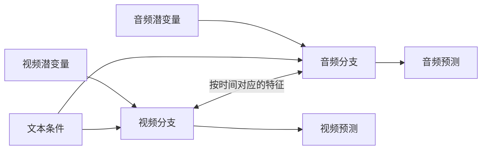

# 第 21 章 音视频

一个人把杯子放在桌上，观众会同时看到接触和听到碰撞。若声音提前，杯子像是在碰到桌面之前就发出了响动；若声音落后，动作又显得拖沓。人物说话时，口型与语音的关系更加细密，嘴唇闭合、呼气和音节转换都发生在很短的时间范围内。

声音还会跨越画面边界。镜头切到听者，刚才说话的人可以继续在画外发言；拍摄一扇尚未打开的门，也可以先听到门后的脚步。因此，音视频生成既需要准确的局部对应，也需要理解哪些声音与当前可见内容有关。

我们先看音频怎样表示和对齐，再讨论已有语音驱动画面、说话人保持和联合音视频生成。最后结合 LTX-2 与 UniAVGen，查看跨模态信息怎样在网络中交换。

## 21.1 音频表示与对齐

视频以帧记录画面，音频以更密集的采样记录波形。若声音的采样率为24 kHz，一秒钟每个声道包含24000个采样值；视频即使以每秒25帧播放，同一秒也只有25张画面。直接把波形采样与视频帧一一对应，既没有合适的长度关系，也难以表达声音结构。

音频模型通常先把波形变成较紧凑的表示。一类做法使用短时傅里叶变换，观察短窗口中不同频率的能量，再转换为 Mel 频谱。Mel 频谱的每个时间位置对应一段波形，可以保留语音和音色中的许多特征，同时显著缩短时间序列。

频谱的窗口长度与移动步长具有不同含义。窗口决定每次分析覆盖多长声音，步长决定相邻频谱位置间隔多久。例如，窗口覆盖40毫秒、每20毫秒移动一次，相邻分析窗口会有重叠，每秒产生约50个时间位置。窗口较长有利于区分频率，较短则更容易定位突发声音，需要根据任务选择。

另一类表示通过神经音频编码器得到离散码或连续潜变量。离散编码可以由序列模型逐步预测，连续潜变量则适合扩散和流匹配。两者都需要相应的解码器。若生成的是 Mel 频谱，还常需要声码器恢复波形，因为仅有能量表示未必保留完整的相位信息。

音频编码也会压缩时间。为了说明对齐，考虑五秒、25 fps的视频，共有125帧。假设音频频谱每20毫秒产生一个位置，再由编码器按两倍时间步长压缩，就得到约125个音频潜位置。视频若采用首帧保留、其余按四倍压缩的 VAE，则会有32个潜时间位置。

| 表示 | 五秒内的时间位置数量 | 位置主要表达什么 |
|---|---:|---|
| 25 fps 视频帧 | 125 | 一个显示时刻的画面 |
| 步长20毫秒的音频频谱 | 约250 | 一个短窗口的频率分布 |
| 再压缩两倍的音频潜变量 | 约125 | 较短声音片段的压缩特征 |
| 四倍时间压缩的视频潜变量 | 32 | 多帧画面的压缩特征 |

这些数量只是示例中的配置。音频潜位置与原始视频帧碰巧相等，也不能直接视为相同时间单位；视频生成网络实际读取的，已经是压缩后的32个位置。跨模态注意力需要依据时间戳或时间覆盖范围建立联系。

还要区分位置的起点与中心。频谱第一个窗口可能以零时刻为中心并使用填充，因果音频编码器则可能只读取此前的采样。视频 VAE 的首个潜位置也可能单独处理首帧。若忽略这些边界约定，音频和视频即使总时长相同，仍可能整体错开。

准备训练数据时，应先确定同一段物理时间，再分别裁剪画面与声音。改变视频帧率时保留原时间戳，重采样音频时保留原时长。如果每段分别从各自文件开头截取，却没有处理容器里的起始偏移，模型就会反复看到不准确的同步关系。

立体声又增加了左右声道之间的联系。把两个声道当作毫无关系的样本分别生成，可能破坏声源位置和空间感。可以联合编码两个声道，或使用能够保持相位与通道关系的表示。最终的声像、混响和音量变化，也需要与镜头中的空间关系相容。

对齐问题因此存在于几个层次：波形采样率、频谱步长、音频编码压缩、视频帧率与视频编码压缩。后续模型可以使用不同长度的序列，只要这些序列仍然共享明确的时间关系。

## 21.2 语音驱动与口型

给定一段已经录好或合成的语音，生成说话视频，时间上的自由度会小一些。声音已经规定音节、停顿和大致时长，视频模型需要据此安排嘴部运动，并结合人物参考保持外观。

音频条件可以来自 Mel 频谱，也可以来自语音编码器提取的特征。不同特征保留的信息不同：较偏向识别的表示强调说了什么，较细的声学表示还保留音调、节奏和呼吸。只保留文字内容，往往不足以决定同一句话的实际口型时间，因为不同语速、连读和停顿会改变音节的位置。

一个视频帧也不宜只读取一个瞬时音频位置。发音具有协同变化，嘴唇会提前为后续声音作准备，同一个音在不同上下文中也会呈现不同口型。让当前画面读取附近一段音频，可以为这种变化提供依据。离线生成能够使用前后声音，实时系统则需要决定允许读取多少未来音频，并把这段等待计入延迟。

训练时，模型还需要避免依赖视觉捷径。如果输入中已经保留目标帧的完整嘴部，网络可能直接沿用它，即使没有认真读取语音，也能得到较小重建误差。可以遮住待修改的嘴部区域，保留身份、头部姿态和周围画面，再要求模型根据声音恢复这部分内容。

遮挡范围需要适度。范围过小，原嘴形仍然泄露给模型；范围过大，下巴轮廓、脸部光照和头部姿态也会缺少依据。实际处理还要考虑脸部裁剪是否稳定。若人脸框每帧轻微跳动，模型可能把这种抖动带进嘴部生成，即使音频对齐正确，播放时也会感觉整张脸在晃。

逐像素重建可以帮助恢复外观，但对同步还需要更直接的监督。Wav2Lip 使用预先训练的同步判别网络，让短视频窗口与对应语音窗口的特征相互接近。训练这个判别网络时，同步片段构成正样本，错开的音画片段构成负样本；训练嘴部生成器时，同步网络提供判断口型与声音是否匹配的信号。

这种信号覆盖一小段连续动作，比单独检查某一张嘴形更有用。一个闭嘴画面可能对应很多声音，连续几帧中的闭合、张开和过渡，才更能区分语音时序。生成器在同步约束下，除了恢复清楚的嘴唇，还需要形成与音频相配的变化过程。

同步网络的权重可以冻结，但它对输入画面的梯度仍需保留。生成器先产生嘴部画面，同步网络再比较这段画面与音频，损失沿着画面输入传回生成器。如果把同步网络的整个前向计算放进无梯度区域，就会切断这条监督路径，只得到一个用于记录的分数。采用潜空间生成时，还要把解码过程纳入这条路径，或使用相应的近似设计。

同步网络的训练质量也会影响结果。如果它把人物身份、画面风格或固定背景当成判断线索，就可能给错误口型较高分数。负样本应当包含相近人物、相似内容以及不同程度的时间偏移，使网络更关注实际的音画对应。

扩散口型模型还要处理一个问题：生成目标通常在带噪潜空间计算，同步网络却往往接收较干净的画面。LatentSync 研究了如何在音频条件扩散中加入同步监督，并针对视觉捷径和时间一致性进行训练。理解这种设计时，应当跟踪同步损失实际读取的内容：由哪个采样时刻估计干净结果，如何解码成画面，梯度又怎样回到生成网络。

如果只在极少数生成阶段检查同步，其他阶段可能仍主要依赖视觉条件；若每个阶段都完整解码和运行同步网络，训练成本又会增加。同步信号的时间安排、权重和可微路径，因此与生成骨干本身一样重要。

实时口型生成还需要减少采样步数，并限制对未来画面的依赖。Lip Forcing 将音频条件的双向视频教师蒸馏为少步因果学生，结合口型同步监督，把前面长视频章节中的按块生成思想用于口型任务。其研究也说明，参考外观与同步程度可能对引导强度有不同反应，少步蒸馏需要保留对发音最有帮助的训练信号。

已有语音提供了稳定的时间依据，但身体表演仍然具有选择空间。模型可以让人物点头、眨眼或移动视线；这些动作若过于频繁，也可能分散观众对对白的注意。嘴部同步、头部自然度与身份保持，需要分别观察，再通过联合训练或不同控制条件协调。

## 21.3 说话人与音色

嘴部动作对应语音时间，音色则帮助听者识别说话人。同一句话可以由不同人物以不同声音说出，同一个人也可以用不同情绪、音量和速度说话。生成系统需要把这些可变因素与希望保留的身份线索分开使用。

先合成语音再驱动画面时，可以为每个人物保留相应的声音参考或说话人条件。文本规定台词，声音参考帮助保持音色，语速和停顿条件进一步规定表达。生成画面时，再把对应音轨送给这个人物的视觉条件分支。

如果每个镜头都独立选择一个听起来相似的声音，整段对话仍可能显得人物在换声。可以跨镜头保留同一说话人条件，并检查音高分布、发声习惯和录音环境。情绪变化允许声音发生变化，身份保持则要求这些变化仍然具有连续性。

从一张人脸图片可以推测某些声音特征，但外观通常不足以唯一决定真实音色。若任务要求跨镜头保持指定声音，明确的音频参考提供了更可靠的依据。在联合生成中，也需要确认模型究竟接受独立音色条件，还是仅根据画面和文字估计一种声音。

两个人交替说话时，还需要建立视觉主体与音频主体的对应。可以先把对白分成带说话人标识的时间区间，再把每段声音关联到人物参考和当前画面位置。编号用于持续表达同一人物，画面区域则随着镜头和人物移动而更新。

例如，第一人在第0—2秒说话，第二人在第2—4秒回应。若直接把混合音轨平均编码，再让画面中的所有人物读取同样的音频，两人的嘴都可能跟着同一段声音运动。需要让网络获得说话区间与主体身份，或通过训练学会把音频内容分配给相应的脸部区域。

说话人分离与画面中的脸部跟踪可以帮助构造这些条件，但二者仍需对应。音频能够分出“声音A”和“声音B”，并不直接说明哪张脸对应A。可以利用同步线索、参考声音和已知镜头信息建立关联。人物转头、短暂遮挡或离开画面后，身份标识还应继续保留。

画外音进一步说明了声音与可见嘴部并非始终一一对应。镜头拍摄听者时，说话者可以暂时不可见；旁白也可以完全不属于画面中的人物。条件需要表达声音来源，否则模型可能让当前唯一可见的人跟着旁白张嘴。听者仍可有呼吸、微笑或回应动作，但这些变化需要由表演条件决定。

重叠讲话更难处理。两条语音同时存在时，混合后的声学特征包含两个音源，单个主体分支可能难以分辨自己应当遵循哪一条。独立音轨、说话人特征与区域条件能提供更明确的依据，也使训练数据中的主体对应更加重要。

最后，音色一致与声场一致需要分开考虑。一个人从室内走到室外，音色应当保持，混响和背景声可以改变；只切换拍摄角度时，房间的整体声场则通常继续存在。把身份特征与录音环境全部绑定到同一参考，可能使人物在不同地点仍带着原房间的回声。

## 21.4 联合生成

已有语音驱动画面，适合台词和声音已经确定的任务。先生成无声视频再配声音，也便于保留既有画面。音视频联合生成则让两种内容在采样期间共同形成，可以把动作、语气和声音事件放进同一生成过程。

一种常见结构使用两个编码器：视频 VAE 产生时空潜变量，音频编码器产生声音潜变量。训练时分别给它们加噪，再由两条生成分支预测各自的恢复方向。视频分支处理大量空间位置，音频分支处理较密的时间变化，两者通过跨模态注意力交换信息。

假设正在生成杯子落在桌面的片段。视频分支逐渐形成手、杯子和桌面之间的关系，音频分支逐渐形成安静背景与短促碰撞。通过跨模态联系，声音能够读取接触发生的时间和物体信息，画面也能读取相应的事件节奏。两边的预测随采样继续调整，而不必等其中一边全部完成。

跨模态读取需要决定范围。全局注意力允许一个声音位置读取全部视频，也允许一帧读取整段音频，信息充分但配对很多，而且模型需要自行学习正确时刻。局部时间窗口缩小了搜索范围，对同步更直接，却可能遗漏较长的声音或先于事件出现的线索。模型可以根据声音和画面各自的特点，采用不同的时间范围。

两边的噪声时间也可以有不同安排。若始终一起加同样强度的噪声，模型主要学习两种内容共同恢复；若训练包含一边清楚、另一边带噪的组合，还可以学习给定声音生成画面，或给定画面生成声音。要支持这些任务，条件状态和相应数据需要在训练中出现，推理时只固定某个输入并不自动带来可靠的条件生成能力。

联合损失通常包含音频和视频各自的生成目标。计算权重时，要考虑元素数量与数值尺度。视频可能有大量空间 token，若直接把所有误差相加，视觉部分容易占据主要贡献。先在各模态内部规范化，再按需要选择权重，有助于让两类学习信号得到合适分配。

生成损失之外，可以加入针对同步、语音内容或身份的监督。但附加目标也有自己的适用范围。同步模型通常针对说话人片段训练，未必善于判断雷声、背景音乐与画面的关系；语音识别可以检查台词，却不会保证音色和情绪。应当让不同监督分别承担相应职责。

训练数据的对应质量尤其重要。网络需要看到同一时间段内的图像与声音，视频描述还应区分视觉内容、声音事件和实际台词。“一个男人在说话”提供了人物活动，却没有给出他到底说了什么；若希望逐字控制，需要另有准确转写和相应条件。

错误配对会形成系统性的模糊监督。假设碰撞声在部分训练片段提前、部分片段落后，模型就很难学习稳定的接触时刻；若声音来自后期配乐，画面中的物体与音效也未必具有直接物理联系。清洗与标注应当保留这些区别，而非把所有同时存在的声音都当成可见动作产生的声音。

联合模型也可以从已有音频和视频模型出发。先保留两边的生成能力，再训练交换信息的模块，之后逐步联合调整。新加入的残差分支若从较小影响开始，有助于减少初期对已有能力的干扰。随着训练进行，跨模态信息才逐步参与各自的生成。

这条路线要求两边的时间尺度、特征宽度和生成目标能够配合。音频与视频都叫“扩散模型”，也可能使用不同日程、不同预测参数化及不同时间方向。接入前需要分别弄清它们预测什么，再为交互模块准备明确的输入，而不能只依据模型名称安排联合采样。

## 21.5 LTX-2 与 UniAVGen

LTX-2 使用音频与视频双流 Transformer。视频流处理时空潜变量，音频流处理声音潜变量；每个双流块内，两边分别进行本模态注意力和文本条件读取，再通过双向音视频交叉注意力交换特征，之后继续各自的前馈计算。

视频 token 既有时间又有空间坐标，音频 token 主要按时间排列。LTX-2 在视频流内部使用三维位置编码，在音频流内部使用时间位置编码；跨模态交互时则按时间建立位置联系。这样，声音无需被赋予一个任意的画面横纵坐标，也能与对应时段的视觉位置发生关联。

这对一个有许多空间 token 的时刻尤其重要。同一小段声音可能来自画面中的嘴部、门或车辆，交叉注意力还需要根据内容判断应该读取哪个区域。时间编码先限制“什么时候”，特征中的语义和空间内容再帮助确定“与什么有关”。

在技术报告描述的音频配置中，LTX-2 将左右声道转换为16 kHz的双声道 Mel 频谱，再通过音频 VAE 压缩为序列，每个潜 token 约覆盖四十分之一秒，使用128维特征。解码频谱后，声码器再恢复为24 kHz立体声波形。输入分析采样率、潜序列速率和最终波形采样率因此需要分别理解。

如果生成五秒声音，这种潜表示大约只有125个时间位置，远少于波形采样数。模型可以在这些压缩位置上学习声音结构，声码器再补足波形级细节。最终听到的高采样率音频，也不能直接被解释为生成网络逐一预测了所有高频采样点。

LTX-2 还把文本条件与跨模态条件的引导分开考虑。可以比较完整条件预测与减弱文本条件时的预测，调整描述遵循；也可以比较允许和抑制音视频交流时的预测，调整两种模态之间的依赖。这样的设计提供了不同方向的控制，但引导过强仍可能改变自然度和稳定性，需要同时听声音、看动作来选择。

UniAVGen 同样采用双分支，却对两个方向的交互使用不同安排。它关注的一个问题是：音频时间序列与视频潜时间位置并不等长，而且口型会受到前后语音的共同影响。

在音频到视频方向，某个视频潜位置读取对应时段及邻近时段的音频特征。这个时间窗口让嘴部生成能够利用前后发音，减少只依赖当前瞬间造成的机械变化。边界处需要按约定补齐上下文，窗口大小则影响可用语音范围和计算量。

在视频到音频方向，一个视频潜位置常覆盖多个音频位置。若让这些音频位置始终读取完全相同的视觉特征，较细的时间差别就被忽略。UniAVGen 根据音频位置所处的时间，在相邻视频潜特征之间构造插值上下文，再由音频特征读取它。这里插值的是内部特征，用于提供较平滑的时间条件，并不等于在最终视频帧之间直接混合像素。

可以用一个时间例子理解：两个视频潜位置分别代表相邻时段，而它们之间存在几个音频潜位置。更靠近前者的音频主要读取前一个视觉特征，之后逐渐增加后一个特征的影响。声音因此获得较细的时间线索，同时保留视频压缩带来的计算收益。

UniAVGen 还预测面部软掩码，引导与讲话相关的跨模态交流更多发生在面部区域。音频对嘴部的影响较强，对静止墙面的直接影响则可以较小。训练初期的面部监督帮助形成这种区域选择，之后逐步放松约束，使模型能够继续学习更丰富的联系。

区域选择与时间选择共同发挥作用。时间窗口对应合适的语音片段，面部权重对应更相关的空间位置。如果只处理时间，语音特征可能影响整幅画面；如果只处理脸部而没有正确时间关系，嘴部仍可能跟着错误音节运动。

这两个例子展示了联合模型中的具体设计选择：音频怎样压缩，时空坐标怎样对应，特征在哪些层交流，以及两个方向是否使用相同结构。判断一个新模型时，可以沿这些环节读实现，再看它如何组织文本、参考图和可选的声音条件，避免把“支持音视频”理解成完全相同的算法。

## 21.6 对白与环境音

一段完整声音通常包含对白、动作声、环境声和音乐，它们与画面的对应方式不同。对白要求音节与嘴部相配，动作声要求接触、碰撞或开合发生在合适时间，环境声提供较持续的空间背景，音乐还可以跨越多个镜头形成节奏。

生成或编辑时，可以先明确每类声音的时间范围和来源。人物说话时，语音属于相应说话人；杯子落桌时，动作声属于杯子与桌面的接触；窗外车流则可能在整段室内镜头中持续存在。这些来源可以通过文字、事件标注、独立音轨或模型学到的场景关系表达。

动作声的检查应当围绕事件过程展开。杯子尚未接触桌面时，不应已经出现清楚的落桌声；接触后可能先有短促冲击，再有余振。只让音频中出现“杯子碰撞”的声音，还不足以保证这段声音在正确位置。画面事件的定位和声音起始时刻，需要共同查看。

对白除了同步，还要核对实际内容。有些结果口型与语音节奏相近，但说错了字、漏掉短词或重复句子。可以先用语音识别检查转写，再查看时间对齐与音色；对口型，可以分别观察整体偏移、局部发音和头部运动。一个同步分数通常难以同时覆盖这些问题。

以25 fps视频为例，一帧对应40毫秒，两帧就是80毫秒。整体音轨偏移会影响所有音节，可以通过时间校正处理；如果只有某一句中间几个音节不匹配，整体移动声音又会破坏其他位置，更适合局部重新生成或调整相应片段。先判断误差分布，才能选择合适的修复范围。

镜头切换时，声音也需要自己的连续性。人物的对白可以越过切点，环境混响可以在反应镜头中继续衰减，背景音乐可以维持原来的乐句。如果每个镜头分别生成全部音轨，切点处可能发生音色、底噪和空间感的跳变。保留共享音轨，或向下一段提供合适的声音历史，可以帮助形成连续听感。

这种历史也要区分稳定内容与当前事件。房间声场可以跨镜头延续，已经结束的关门声则应当自然衰减，不能在每次切换后重新响起。把一段完整混音当作长期参考，可能同时保留音色和不应重复的事件；独立音源或更明确的时间条件提供了细分控制的机会。

多人物场景还需要观察声音与嘴部的分配。两个人同时出现在画面中，发言者的口型应当跟随自己的音轨，听者则保留相应反应。镜头转向听者后，声音可以继续在画外存在。若条件只写“画面里有人说话”，模型很难从中确定这一关系，需要保留说话人、台词区间与可见主体信息。

混音时，音量、空间位置与可懂度同样重要。环境声过强会掩盖台词，两个声道处理不一致可能让声源位置突然改变。若需要局部替换一句对白，可以保留环境音和其他声部，只重新处理对应声音与嘴部区域，减少对已经满意内容的影响。

评估时可以先只听声音，检查台词、音色、噪声与断点；再静音观看，检查人物运动和表情；最后一起播放，观察同步、声音来源与空间关系。分开观察有助于发现某一模态的问题，联合播放才能判断两者是否共同描述了同一件事。

当已有画面或声音需要保留时，任务就进一步变成带约束的编辑：换掉一句话但保留表演，改变人物外观但保留动作，或修复局部画面而不打断原有声音。接下来的视频编辑将围绕这些保留与修改的要求展开。
